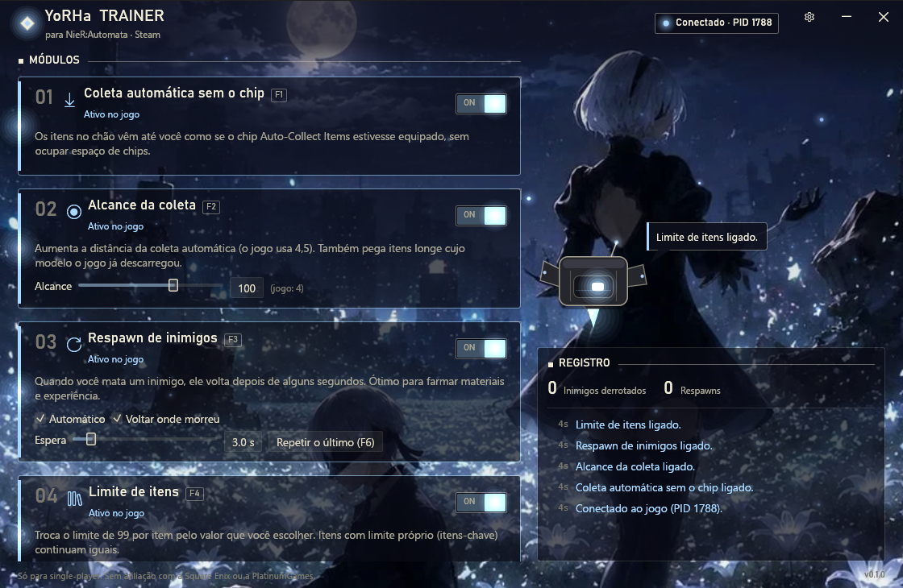
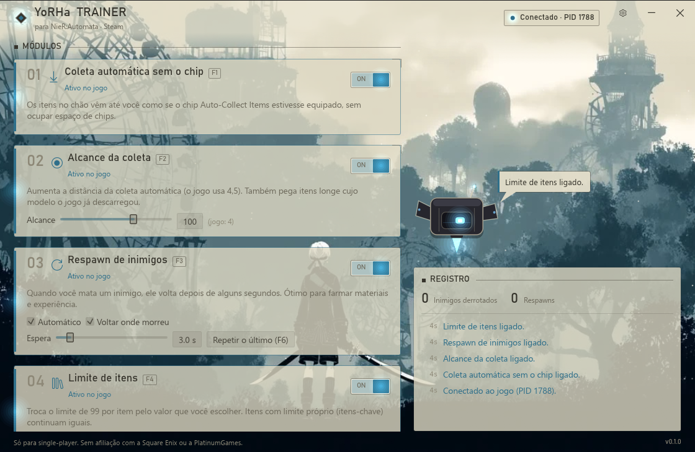

# YoRHa Trainer

A single-player trainer for **NieR:Automata** (Steam), written in Rust, with an interface in
the style of an android's field terminal: paper panels over animated background art, a
floating support unit that reports what happens, and an event log.




## Modules

| Key | Module | What it does |
| --- | ------ | ------------ |
| F1 | **Auto-Collect without the chip** | Dropped items fly to you as if the *Auto-Collect Items* plug-in chip were equipped, without using chip space. |
| F2 | **Collection range** | Raises the auto-collect reach (the game uses 4.5) and also picks up far items whose model the game already unloaded. |
| F3 | **Enemy respawn** | A killed enemy comes back after a delay (default 3 s), where it died or at its original spawn point. **F6** spawns another copy of the last enemy killed. |
| F4 | **Item stack limit** | Replaces the 99-per-item limit with your own value (default 9999). Items with their own limit, like key items, are left alone. |

The trainer connects on its own when the game opens, re-applies the modules you left on, and
takes every change out of the game when you turn a module off or close the trainer.

## Use

1. Download `yorha-trainer.exe` from the releases (or build it, below) and run it. No
   installation and no administrator rights needed.
2. Open NieR:Automata. The status chip turns blue: *Connected*.
3. Turn the modules on, in the window or with the hotkeys (F1–F4, F6). The hotkeys work from
   anywhere while the trainer is connected; they can be turned off in the settings (the gear
   icon).

Settings live in `%APPDATA%\yorha-trainer\config\settings.json`.

### Backgrounds

The settings let you pick *Night lilies*, *Ruins in the fog*, or *My picture* (any PNG, JPEG or
WebP on your computer; only its path is saved).

The two built-in pictures are embedded from `assets/night.*` and `assets/ruins.*` at build
time. If they are missing, the app paints the same two scenes procedurally.

## Build

Requires Rust (stable) on Windows.

```powershell
cargo build --release
```

The executable ends up in `target\release\yorha-trainer.exe`.

## Supported version

The Steam release of NieR:Automata (the 2021 update). Every address is found by signature, so
ASLR and the load address don't matter; if a signature isn't found the card says so and that
module stays off.

## How it works

See [docs/RESEARCH.md](docs/RESEARCH.md) for the reverse engineering behind each module (the
plug-in chip table, the item pickup range check, the item stack limit and how enemies are
created). [cheat-engine/](cheat-engine) has the same cheats as a Cheat Engine table, built from
the `.cea` scripts by `build_ct.py`.

## Credits

- **Created by** Oz Vessalius ([@Silhatote](https://github.com/Silhatote)).
- **Background art:** NieR:Automata artwork; all rights belong to its creators. Upscaled with
  [Upscayl](https://upscayl.org) (Real-ESRGAN).
- **Built with** Rust, [egui / eframe](https://github.com/emilk/egui) and
  [windows-rs](https://github.com/microsoft/windows-rs); Segoe UI and Bahnschrift (Windows fonts).
- **Research:** the game was reverse engineered with [Cheat Engine](https://cheatengine.org).

The icon is generated by `assets/make_icon.py`.

## Disclaimer

For single-player use. Not affiliated with or endorsed by Square Enix or PlatinumGames.
*NieR:Automata* is a trademark of Square Enix. The code is MIT-licensed (see [LICENSE](LICENSE));
the pictures in `assets/` are not covered by that license and belong to their respective owners.
